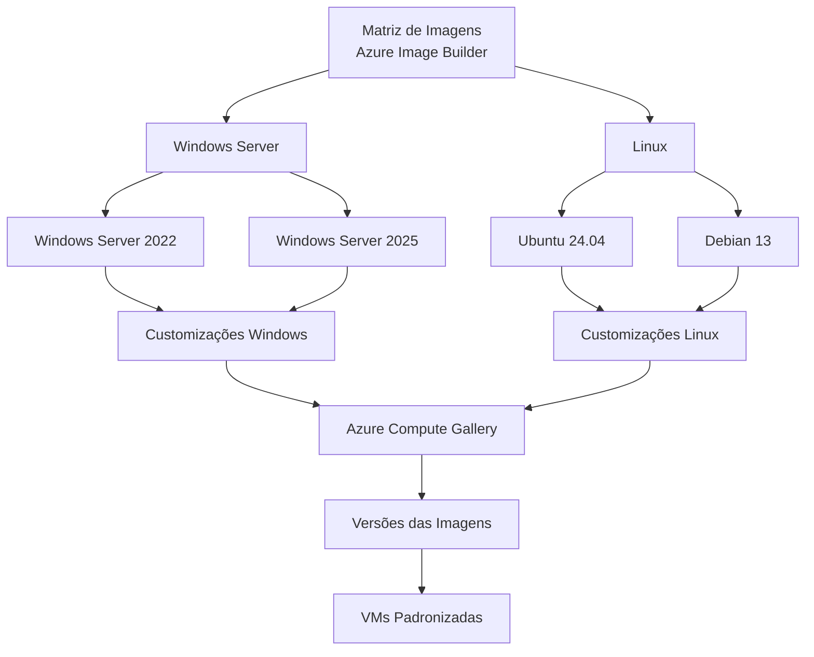
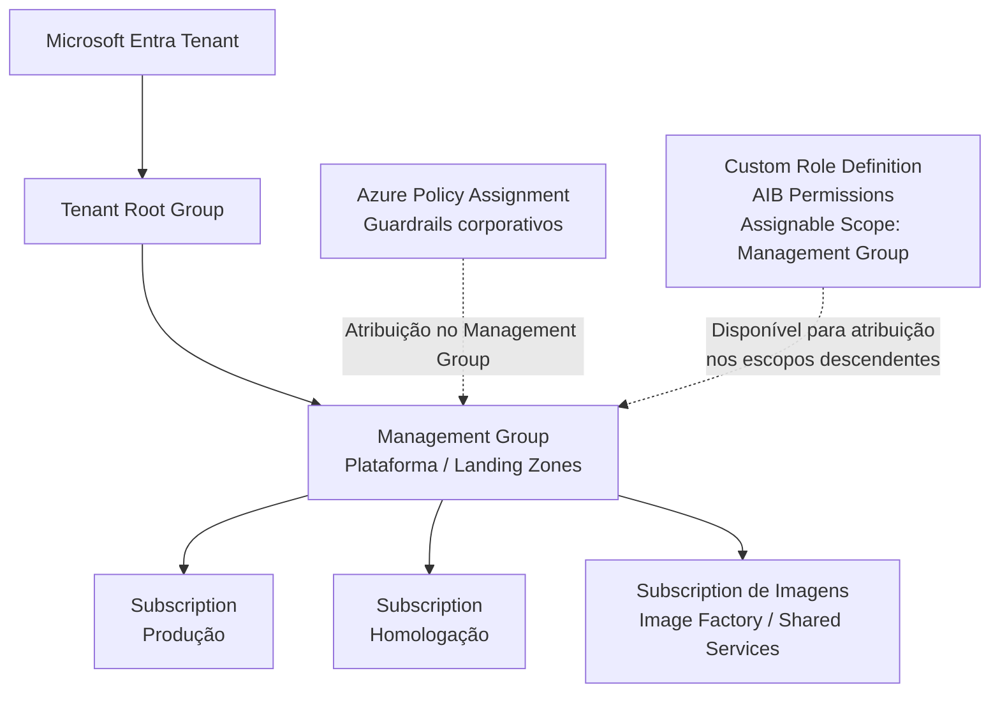
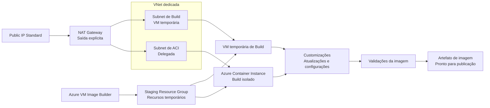
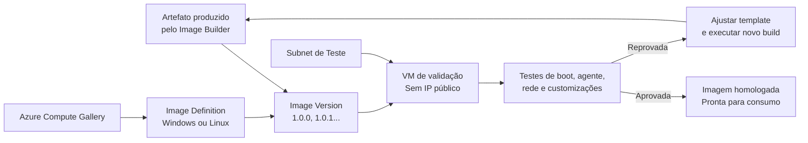

Fala pessoALL! Tranquilidade total?

Hoje vamos trabalhar com **Azure VM Image Builder** para criar imagens personalizadas de Windows Server e Linux.

Sabe quando precisamos provisionar várias VMs com os mesmos pacotes e configurações? Dá para fazer tudo manualmente, claro. O problema começa quando precisamos recriar essas máquinas ou manter todas elas atualizadas.

Para esse laboratório escolhi o Azure VM Image Builder. A ideia é preparar as imagens e publicá-las na **Azure Compute Gallery**, mantendo um controle das versões que poderão ser utilizadas nas próximas VMs.

Vou trabalhar com quatro sistemas operacionais:

- Windows Server 2022;
- Windows Server 2025;
- Ubuntu 24.04 LTS;
- Debian 13.

Vamos configurar uma VNet dedicada, preparar as permissões e montar os templates. Depois precisamos executar os builds e criar VMs para testar cada imagem.

> **Laboratório em atualização:** a infraestrutura de rede, a Managed Identity, a Compute Gallery e as quatro Image Definitions já foram criadas. Os templates, builds, versões publicadas e testes nas VMs ainda estão em validação. Vou incluir os prints dessas etapas conforme forem concluídas.
{: .prompt-warning }

Agora vamos colocar a mão na massa!

---

## O que é o Azure VM Image Builder?

O **Azure VM Image Builder (AIB)** automatiza a criação de imagens personalizadas de máquinas virtuais. Escolhemos uma imagem base, informamos quais customizações devem ser aplicadas e definimos onde a imagem final será armazenada.

Aqui vou utilizar a **Azure Compute Gallery** para organizar as imagens e suas versões. É a partir delas que vamos provisionar as VMs de validação.

O caminho que seguiremos é simples: **Marketplace → Image Builder → Compute Gallery → VM de teste**.



---

## O que vamos construir neste laboratório?

Neste laboratório vamos criar quatro imagens customizadas:

| Sistema Operacional | Imagem base                                   | Destino               |
| ------------------- | --------------------------------------------- | --------------------- |
| Windows Server 2022 | Windows Server 2022 Datacenter: Azure Edition | Azure Compute Gallery |
| Windows Server 2025 | Windows Server 2025 Datacenter: Azure Edition | Azure Compute Gallery |
| Ubuntu 24.04 LTS    | Ubuntu 24.04 LTS Server Gen2                  | Azure Compute Gallery |
| Debian 13           | Debian 13 Gen2                                | Azure Compute Gallery |

Todas as definições serão criadas como:

```text
Generalized
Generation 2
TrustedLaunchSupported
```

Uma imagem **Generalized** não mantém informações específicas da máquina utilizada durante a criação, como nome do computador, contas locais exclusivas e determinados identificadores do sistema.

Isso permite que a mesma versão seja utilizada para criar várias VMs independentes.

Uma imagem **Specialized**, por outro lado, preserva o estado e diversas configurações da máquina de origem. Esse modelo pode ser útil em cenários específicos, mas não será utilizado neste laboratório.


## Arquitetura do laboratório

Separei a arquitetura em três partes para mostrar como estão organizadas as permissões, a rede de build e a publicação das imagens.

**GOVERNANÇA E PERMISSÕES**

---
**REDE E PROCESSO DE BUILD**

---
**PUBLICAÇÃO E VALIDAÇÃO DA IMAGEM CRIADA**


---

## Sobre a nomenclatura

Para facilitar os testes, vou seguir um padrão de nomes baseado no Cloud Adoption Framework (CAF).

| Recurso                       | Nome sugerido                |
| ----------------------------- | ---------------------------- |
| Resource Group                | `rg-aib-lab-wus2-001`        |
| Virtual Network               | `vnet-aib-lab-wus2-001`      |
| Subnet para Build VM          | `snet-aib-build-wus2-001`    |
| Subnet para ACI               | `snet-aib-aci-wus2-001`      |
| Subnet para VMs de teste      | `snet-aib-test-wus2-001`     |
| Public IP do NAT Gateway      | `pip-nat-aib-lab-wus2-001`   |
| NAT Gateway                   | `nat-aib-lab-wus2-001`       |
| Managed Identity              | `id-aib-lab-wus2-001`        |
| Azure Compute Gallery         | `gal_aib_lab_wus2_001`       |
| Custom Role                   | `role-aib-lab-image-builder` |
| Image Definition Windows 2022 | `imgdef-winsrv2022`       |
| Image Definition Windows 2025 | `imgdef-winsrv2025`       |
| Image Definition Ubuntu 24.04 | `imgdef-ubuntu2404`       |
| Image Definition Debian 13    | `imgdef-debian13`         |

> O nome da galeria usa underline (`_`) porque esse recurso tem regras próprias de nomenclatura. 
{: .prompt-info }

> As subnets estão configuradas como privadas (`defaultOutboundAccess: false`). Vamos usar um NAT Gateway para que a VM temporária consiga acessar os repositórios de atualização. Sem conectividade, o build pode falhar. 
{: .prompt-info }

---

## Pré-requisitos

Antes de iniciar, vamos considerar alguns pré-requisitos:

* Permissões para criar os recursos e gerenciar atribuições RBAC. Como a Custom Role será criada no Management Group, é necessário possuir `Microsoft.Authorization/roleDefinitions/write` naquele escopo. Ser Owner apenas da subscription não garante essa permissão;
* Região com suporte ao Azure VM Image Builder;
* Cotas disponíveis para criação temporária de recursos de build;
* Nenhuma Azure Policy bloqueando recursos temporários, como:
  * Virtual Machine;
  * Network Interface;
  * Disk;
  * Storage Account;
  * Azure Container Instance;
  * Network Security Group;
  * Private Endpoint, dependendo da topologia.

> Confira as Azure Policies aplicadas à assinatura. O Image Builder cria recursos temporários durante o build, e alguma política pode impedir essa criação. 
{: .prompt-warning }

> O laboratório gera custo. O NAT Gateway continua cobrando mesmo sem um build em execução, e as versões na Compute Gallery ocupam armazenamento. Ao terminar, revise o que pode ser removido. 
{: .prompt-info }

---

## Imagens base que serão utilizadas

Vamos utilizar imagens oficiais do Marketplace.

### Windows Server 2022

```text
Publisher: MicrosoftWindowsServer
Offer: WindowsServer
SKU: 2022-datacenter-azure-edition
Version: latest
```

### Windows Server 2025

```text
Publisher: MicrosoftWindowsServer
Offer: WindowsServer
SKU: 2025-datacenter-azure-edition
Version: latest
```

### Ubuntu 24.04 LTS

```text
Publisher: Canonical
Offer: ubuntu-24_04-lts
SKU: server
Version: latest
```

### Debian 13

```text
Publisher: Debian
Offer: debian-13
SKU: 13-gen2
Version: latest
```

---

## Passo 1 - Registrar os providers necessários

Vamos começar conferindo os Resource Providers necessários. Se algum ainda não estiver registrado, faça o registro antes de avançar.

No Cloud Shell:

```bash
az provider register --namespace Microsoft.VirtualMachineImages
az provider register --namespace Microsoft.Compute
az provider register --namespace Microsoft.KeyVault
az provider register --namespace Microsoft.Storage
az provider register --namespace Microsoft.Network
az provider register --namespace Microsoft.ContainerInstance
az provider register --namespace Microsoft.ManagedIdentity
```

{: .shadow .rounded-10 }
<br>

Em seguida valide se os providers foram registrados corretamente:

```bash
az provider show --namespace Microsoft.VirtualMachineImages --query registrationState -o tsv
az provider show --namespace Microsoft.Compute --query registrationState -o tsv
az provider show --namespace Microsoft.Network --query registrationState -o tsv
az provider show --namespace Microsoft.ContainerInstance --query registrationState -o tsv
```

{: .shadow .rounded-10 }
<br>

O retorno esperado é **Registered**

> Caso algum provider esteja como `Registering`, consulte novamente até aparecer `Registered`. 
{: .prompt-info }

---

## Passo 2 - Criar o Resource Group

Vamos criar o Resource Group do laboratório na região West US 2. Ele será utilizado pelos recursos de rede, identidade e galeria.

Pelo portal:

1. Acesse o **Azure Portal**;
2. Pesquise por **Resource groups**;
3. Clique em **Create**;
4. Informe:
   * Subscription: Informe a subscription que será utilizada para a geração das imagens e alocação dos demais recursos;
   * Resource group: 
   ```text
   rg-aib-lab-wus2-001
   ```
   * Region: `West US 2`;
5. Clique em **Review + Create**;
6. Clique em **Create**.

{: .shadow .rounded-10 }
<br>

---

## Passo 3 - Criar a VNet dedicada para o build

O build utilizará uma VNet própria. Vamos separar a subnet da VM temporária, a do ACI e a das VMs de teste.

Neste exemplo iremos utilizar 3 subnets:

| Subnet                    | Finalidade                                                              |
| ------------------------- | ----------------------------------------------------------------------- |
| `snet-aib-build-wus2-001` | Subnet onde a VM temporária de build será criada                        |
| `snet-aib-aci-wus2-001`   | Subnet reservada para o Azure Container Instance usado no build isolado |
| `snet-aib-test-wus2-001`  | Subnet onde as VMs de validação da imagem serão criadas no final do laboratório |

> O ACI participa do build isolado. Ele é temporário e não fará parte da imagem publicada na galeria.
{: .prompt-info }

1. Pesquise por **Virtual networks**;
2. Clique em **Create**;
3. Informe:
   * Resource group: `rg-aib-lab-wus2-001`;
   * Name:
   ```text
   vnet-aib-lab-wus2-001
   ```
   * Region: `West US 2`;
4. Em **IP Addresses**, configure:

   * Address space:
   ```text
   10.250.0.0/16
   ```
5. Crie as subnets:

   * Subnet para criação da VM Temporária:
   ```text
   snet-aib-build-wus2-001
   ``` 
   com 
   ```text
   10.250.1.0/24
   ```
   
   * Subnet para criação do ACI de forma isolada:
    ```text
    snet-aib-aci-wus2-001
    ``` 
    com 
    ```text
    10.250.2.0/24
    ```

   * Subnet para as VMs de validação da imagem:
    ```text
    snet-aib-test-wus2-001
    ``` 
    com 
    ```text
    10.250.3.0/24
    ```
6. Clique em **Review + Create**;
7. Clique em **Create**.

{: .shadow .rounded-10 }
<br>

> Confira a opção **Private subnet**. Nosso laboratório usará saída explícita para a internet por meio do NAT Gateway.
{: .prompt-warning }

---

## Passo 4 - Criando o NAT Gateway

Como as subnets estão privadas, precisamos de uma saída para as atualizações do Windows e do Linux. Vamos associá-las ao **NAT Gateway**.

1. Pesquise por **NAT Gateways**;
2. Clique em **Create**;
3. Informe:
   * Resource group: `rg-aib-lab-wus2-001`;
   * Name:
   ```text
   nat-aib-lab-wus2-001
   ```
   * Region: `West US 2`;
   * SKU: Selecione a opção `Standard`
4. Em **Outbound IP**, configure:
   * Clique em **Add public IP addresses or prefixes**;
   * Clique em **Create a public IP address**;
   * Name:
   ```text
   pip-nat-aib-lab-wus2-001
   ```
   * Clique em **OK** e em seguida em **SAVE**
  
{: .shadow .rounded-10 }
<br>

5. Em **Networking**:
   * Virtual Network: selecione `vnet-aib-lab-wus2-001`;
   * Select specific subnets: selecione `snet-aib-build-wus2-001`, `snet-aib-aci-wus2-001` e `snet-aib-test-wus2-001`
6. Clique em **Review + Create**;
7. Clique em **Create**.

{: .shadow .rounded-10 }
<br>

---

## Passo 5 - Preparar a subnet do ACI e a Managed Identity

### Delegando a subnet do ACI

Agora vamos delegar a subnet que será usada pelo Azure Container Instance durante o build isolado.

Para esse passo, vamos utilizar o Cloud Shell:

```bash
az network vnet subnet update \
  --resource-group rg-aib-lab-wus2-001 \
  --vnet-name vnet-aib-lab-wus2-001 \
  --name snet-aib-aci-wus2-001 \
  --delegations Microsoft.ContainerInstance/containerGroups
```
{: .shadow .rounded-10 }
<br>

Agora vamos guardar os IDs das subnets, pois eles serão usados no template do Image Builder:

```bash
BUILD_SUBNET_ID=$(az network vnet subnet show \
  --resource-group rg-aib-lab-wus2-001 \
  --vnet-name vnet-aib-lab-wus2-001 \
  --name snet-aib-build-wus2-001 \
  --query id \
  -o tsv)

ACI_SUBNET_ID=$(az network vnet subnet show \
  --resource-group rg-aib-lab-wus2-001 \
  --vnet-name vnet-aib-lab-wus2-001 \
  --name snet-aib-aci-wus2-001 \
  --query id \
  -o tsv)

echo $BUILD_SUBNET_ID
echo $ACI_SUBNET_ID
```
{: .shadow .rounded-10 }
<br>

> Esses IDs serão utilizados no campo `vmProfile.vnetConfig` dos templates. 
{: .prompt-tip }

### Criando a User Assigned Managed Identity

Vamos criar uma **User Assigned Managed Identity**. Ela será utilizada para acessar a rede e publicar as imagens na Compute Gallery. No Passo 8 configuraremos suas permissões.

Criaremos uma **User Assigned Managed Identity**:

1. Pesquise por **Managed Identities** e clique em **Create**:

{: .shadow .rounded-10 }
<br>

2. Informe:

   * Resource group: `rg-aib-lab-wus2-001`;
   * Region: `West US 2`;
   * Name: 
   ```text
   id-aib-lab-wus2-001
   ```
3. Não será necessário selecionar Isolation Scope, basta clicar em **Next**;
4. Coloque as tags padrões elegíveis na governança conforme a sua necessidade;
5. Clique em **Create**.

{: .shadow .rounded-10 }
<br>

Agora vamos capturar os IDs da identidade, pois iremos utilizá-los nos próximos passos:

```bash
SUBSCRIPTION_ID=$(az account show --query id -o tsv)

IDENTITY_ID=$(az identity show \
  --resource-group rg-aib-lab-wus2-001 \
  --name id-aib-lab-wus2-001 \
  --query id \
  -o tsv)

IDENTITY_CLIENT_ID=$(az identity show \
  --resource-group rg-aib-lab-wus2-001 \
  --name id-aib-lab-wus2-001 \
  --query clientId \
  -o tsv)

IDENTITY_PRINCIPAL_ID=$(az identity show \
  --resource-group rg-aib-lab-wus2-001 \
  --name id-aib-lab-wus2-001 \
  --query principalId \
  -o tsv)

echo $IDENTITY_ID
echo $IDENTITY_CLIENT_ID
echo $IDENTITY_PRINCIPAL_ID
```

{: .shadow .rounded-10 }
<br>

---

## Passo 6 - Criar a Azure Compute Gallery

Agora vamos criar o repositório que receberá as imagens customizadas.

> Pule esta etapa caso você já tenha uma galeria criada. 
{: .prompt-info }

Pelo portal:

1. Pesquise por **Azure Compute Galleries**;
2. Clique em **Create**;
3. Na aba **Basics** informe:
   * Resource group: `rg-aib-lab-wus2-001`;
   * Name: 
   ```text
   gal_aib_lab_wus2_001
   ```
   * Region: `West US 2`;
   * Description: `Esta galeria de imagens será utilizada para criações padronizadas exclusivas ao Azure Image Builder` - *A descrição é opcional, mas altamente recomendável*

{: .shadow .rounded-10 }
<br>

4. Na aba **Sharing** manteremos o método via RBAC, pois não iremos produzir uma imagem a ser compartilhada publicamente para comunidade;
5. Adicione as **Tags** conforme a governança da sua empresa;
6. Clique em **Review + Create**;
7. Clique em **Create**.

{: .shadow .rounded-10 }
<br>

---

## Passo 7 - Criando as Image Definitions

A Azure Compute Gallery trabalha com alguns conceitos importantes:

| Conceito         | Explicação                                                   |
| ---------------- | ------------------------------------------------------------ |
| Gallery          | Galeria onde as imagens ficam organizadas                    |
| Image Definition | Definição lógica da imagem                                   |
| Image Version    | Versão publicada da imagem                                   |
| Generalized      | Imagem preparada para criar novas VMs                        |
| Specialized      | Imagem ainda ligada à identidade/configuração original da VM |

As quatro definições serão criadas como:

* `Generalized`;
* Hyper-V Generation `V2`;
* `TrustedLaunchSupported`.

A definição `TrustedLaunchSupported` permite que a imagem seja utilizada tanto em VMs Gen2 padrão quanto em VMs configuradas com Trusted Launch.

Vamos trabalhar com imagens **Generalized**, pois queremos criar VMs independentes a partir da mesma versão.

**As atividades abaixo utilizaremos o Cloud Shell:**

### Windows Server 2022

```bash
az sig image-definition create \
  --resource-group rg-aib-lab-wus2-001 \
  --gallery-name gal_aib_lab_wus2_001 \
  --gallery-image-definition imgdef-winsrv2022 \
  --publisher RuizSolutions \
  --offer base-windows \
  --sku winsrv2022 \
  --os-type Windows \
  --os-state Generalized \
  --hyper-v-generation V2 \
  --features SecurityType=TrustedLaunchSupported
```

{: .shadow .rounded-10 }
<br>
---

### Windows Server 2025

```bash
az sig image-definition create \
  --resource-group rg-aib-lab-wus2-001 \
  --gallery-name gal_aib_lab_wus2_001 \
  --gallery-image-definition imgdef-winsrv2025 \
  --publisher RuizSolutions \
  --offer base-windows \
  --sku winsrv2025 \
  --os-type Windows \
  --os-state Generalized \
  --hyper-v-generation V2 \
  --features SecurityType=TrustedLaunchSupported
```

{: .shadow .rounded-10 }
<br>
---

### Ubuntu 24.04

```bash
az sig image-definition create \
  --resource-group rg-aib-lab-wus2-001 \
  --gallery-name gal_aib_lab_wus2_001 \
  --gallery-image-definition imgdef-ubuntu2404 \
  --publisher RuizSolutions \
  --offer base-linux \
  --sku ubuntu2404 \
  --os-type Linux \
  --os-state Generalized \
  --hyper-v-generation V2 \
  --features SecurityType=TrustedLaunchSupported
```

{: .shadow .rounded-10 }
<br>
---

### Debian 13

```bash
az sig image-definition create \
  --resource-group rg-aib-lab-wus2-001 \
  --gallery-name gal_aib_lab_wus2_001 \
  --gallery-image-definition imgdef-debian13 \
  --publisher RuizSolutions \
  --offer base-linux \
  --sku debian13 \
  --os-type Linux \
  --os-state Generalized \
  --hyper-v-generation V2 \
  --features SecurityType=TrustedLaunchSupported
```

{: .shadow .rounded-10 }
<br>

> Confira a geração da imagem base. Não podemos publicar uma imagem Gen2 em uma definição Gen1. 
{: .prompt-warning }

---

## Passo 8 - Criando a Custom Role para o Azure Image Builder

Já temos a VNet, a Managed Identity e a Compute Gallery. Agora precisamos configurar as permissões para que o Image Builder consiga utilizar a rede e publicar as versões das imagens.

Vou criar uma **Custom Role** com as ações necessárias. Para esse cenário, não precisamos conceder Contributor à Managed Identity no Resource Group inteiro.

### Preparando o JSON

**Baixe o arquivo [Custom_Role_AIB.json](https://github.com/lfrleite/Ruiz-Online/blob/main/Azure%20Image%20Builder/Custom_Role_AIB.json) no meu repositório.**

O arquivo contém estas permissões:

```json
{
  "properties": {
    "roleName": "role-aib-lab-image-builder",
    "description": "Permissões necessárias para o Azure VM Image Builder publicar imagens na Azure Compute Gallery utilizando VNet dedicada.",
    "assignableScopes": [
      "/providers/Microsoft.Management/managementGroups/<MANAGEMENT_GROUP_ID>"
    ],
    "permissions": [
      {
        "actions": [
          "Microsoft.Compute/galleries/read",
          "Microsoft.Compute/galleries/images/read",
          "Microsoft.Compute/galleries/images/versions/read",
          "Microsoft.Compute/galleries/images/versions/write",
          "Microsoft.Compute/images/read",
          "Microsoft.Compute/images/write",
          "Microsoft.Compute/images/delete",
          "Microsoft.Network/virtualNetworks/read",
          "Microsoft.Network/virtualNetworks/subnets/join/action"
        ],
        "notActions": [],
        "dataActions": [],
        "notDataActions": []
      }
    ]
  }
}
```

Antes de importar, substitua `<MANAGEMENT_GROUP_ID>` pelo ID do seu Management Group. Se precisar consultar, use o Cloud Shell:

```bash
az account management-group list --query "[].{Nome:displayName, Id:name}" -o table
```

> Esse arquivo é para a opção **Start from JSON** do Portal. O formato utilizado pelo comando `az role definition create` é diferente. Não misture os dois.
{: .prompt-warning }

> Para criar essa role no Management Group, é necessário ter permissão `Microsoft.Authorization/roleDefinitions/write` nesse escopo. Ser Owner somente da assinatura não é suficiente.
{: .prompt-info }

### Criando a role pelo Azure Portal

1. Acesse **Management groups** e abra o grupo que contém a assinatura do laboratório. No meu caso, `LABS_PRD`.
2. Entre em **Access control (IAM)** e clique em **Add > Add custom role**.

{: .shadow .rounded-10 }
<br>

3. Na aba **Basics**, selecione **Start from JSON**. Os campos estarão vazios antes de importar o arquivo.

<!-- PRINT 020 PENDENTE: Basics com Start from JSON antes do upload. -->

4. Clique no ícone de pasta em **File** e escolha `Custom_Role_AIB.json`. Confira se o nome `role-aib-lab-image-builder` e a descrição foram carregados corretamente.

<!-- PRINT 021 PENDENTE: Basics após upload do JSON, mostrando nome, descrição e validação. -->

5. Abra **Permissions** e confira se as ações foram importadas. Entre elas devem aparecer `Microsoft.Compute/galleries/images/versions/write` e `Microsoft.Network/virtualNetworks/subnets/join/action`.

<!-- PRINT 022 PENDENTE: Aba Permissions com as nove ações da Custom Role. -->

6. Em **Assignable scopes**, confira se o Management Group informado no JSON está correto.

<!-- PRINT 023 PENDENTE: Aba Assignable scopes mostrando o Management Group. -->

> **Assignable scopes** informa onde a role poderá ser utilizada. Isso não concede permissão automaticamente a nenhuma identidade.
{: .prompt-info }

7. Acesse a aba **JSON** e confira o resultado final. Valide o nome da role, as ações e o escopo.

<!-- PRINT 024 PENDENTE: Aba JSON com a definição completa da Custom Role. -->

8. Clique em **Review + create** e finalize em **Create**.

<!-- PRINT 025 PENDENTE: Confirmação da criação da Custom Role. -->

### Atribuindo a role à Managed Identity

Criamos a definição da role. Agora precisamos atribuí-la à Managed Identity para que o Image Builder tenha acesso aos recursos do laboratório.

1. Abra o Resource Group `rg-aib-lab-wus2-001` e acesse **Access control (IAM)**.
2. Clique em **Add > Add role assignment**.
3. Procure a role `role-aib-lab-image-builder`.
4. Em **Members**, selecione **Managed identity** e escolha `id-aib-lab-wus2-001`.
5. Confirme o escopo do Resource Group e finalize em **Review + assign**.
6. Volte em **Role assignments** e confirme se a identidade aparece com a role correta.

<!-- PRINT 026 PENDENTE: IAM do Resource Group mostrando a atribuição à Managed Identity. -->

Se preferir fazer a atribuição pelo Cloud Shell, utilize as variáveis que obtivemos no Passo 5. Confira o escopo antes de executar:

```bash
az role assignment create \
  --assignee-object-id $IDENTITY_PRINCIPAL_ID \
  --assignee-principal-type ServicePrincipal \
  --role "role-aib-lab-image-builder" \
  --scope /subscriptions/$SUBSCRIPTION_ID/resourceGroups/rg-aib-lab-wus2-001
```

Para validar a atribuição sem alterar nenhum recurso:

```bash
RG="rg-aib-lab-wus2-001"
IDENTITY="id-aib-lab-wus2-001"
PID=$(az identity show -g "$RG" -n "$IDENTITY" --query principalId -o tsv)
az role assignment list --assignee-object-id "$PID" --all --include-inherited --fill-principal-name false --query "[].{Role:roleDefinitionName,Scope:scope}" -o table
```

Precisamos encontrar a role atribuída à identidade no Resource Group (ou em um escopo herdado que cubra os recursos). Se a consulta não mostrar nenhuma atribuição, ainda não podemos considerar essa etapa concluída.

---

## Passo 9 - Entender o que o Image Builder cria nos bastidores

Antes de criar a primeira imagem, vale entender uma coisa importante.

Quando você executa o Azure VM Image Builder, ele cria recursos temporários na assinatura para realizar o build. Esse conjunto é criado e destruído pelo próprio serviço, com a permissão que veio do registro do provider, e não pela Managed Identity que configuramos no passo anterior.

Você provavelmente verá um Resource Group temporário parecido com:

```text
IT_rg-aib-lab-wus2-001_<nome-do-template>
```

Dentro dele podem aparecer recursos como:

* VM temporária de build;
* Discos temporários;
* NIC;
* Storage Account;
* Azure Container Instance;
* NSG;
* Recursos de rede temporários.

Esses recursos existem durante o processo de build e são removidos ao final.

> Não saia apagando manualmente o Resource Group temporário no meio do processo. Se for necessário limpar, o ideal é excluir primeiro o Image Template. Apagar recursos temporários na mão pode deixar o template em estado inconsistente. 
{: .prompt-danger }


---

## Passo 10 - Criar o template da imagem Windows Server 2022

Agora vamos criar a primeira imagem.

**Os quatro templates JSON estão descritos abaixo.** Depois dos testes, vou colocar as versões validadas no [repositório de apoio](https://github.com/lfrleite/Ruiz-Online/tree/main/Azure%20Image%20Builder).

Crie o arquivo:

```bash
aib-winsrv2022-template.json
```

Conteúdo:

```json
{
  "type": "Microsoft.VirtualMachineImages/imageTemplates",
  "location": "westus2",
  "identity": {
    "type": "UserAssigned",
    "userAssignedIdentities": {
      "<IDENTITY_ID>": {}
    }
  },
  "properties": {
    "buildTimeoutInMinutes": 180,
    "source": {
      "type": "PlatformImage",
      "publisher": "MicrosoftWindowsServer",
      "offer": "WindowsServer",
      "sku": "2022-datacenter-azure-edition",
      "version": "latest"
    },
    "customize": [
      {
        "type": "PowerShell",
        "name": "CreateBaseFolders",
        "inline": [
          "New-Item -Path 'C:\\Temp' -ItemType Directory -Force",
          "New-Item -Path 'C:\\BuildInfo' -ItemType Directory -Force",
          "Set-Content -Path 'C:\\BuildInfo\\image-info.txt' -Value 'Imagem base Windows Server 2022 criada via Azure VM Image Builder'"
        ]
      },
      {
        "type": "PowerShell",
        "name": "InstallBasicWindowsFeatures",
        "inline": [
          "Install-WindowsFeature -Name Web-Server -IncludeManagementTools",
          "Set-TimeZone -Id 'E. South America Standard Time'"
        ]
      },
      {
        "type": "WindowsUpdate",
        "name": "InstallWindowsUpdates",
        "searchCriteria": "IsInstalled=0",
        "filters": [
          "exclude:$_.Title -like '*Preview*'",
          "include:$true"
        ],
        "updateLimit": 20
      },
      {
        "type": "WindowsRestart",
        "name": "RestartAfterUpdates",
        "restartTimeout": "30m"
      },
      {
        "type": "PowerShell",
        "name": "CorporateOptionalExamples",
        "inline": [
          "New-Item -Path 'C:\\Corporate' -ItemType Directory -Force",
          "Set-Content -Path 'C:\\Corporate\\README.txt' -Value 'Aqui poderiam entrar agentes corporativos, hardening, scripts de segurança ou ferramentas internas.'"
        ]
      }
    ],
    "distribute": [
      {
        "type": "SharedImage",
        "galleryImageId": "/subscriptions/<SUBSCRIPTION_ID>/resourceGroups/rg-aib-lab-wus2-001/providers/Microsoft.Compute/galleries/gal_aib_lab_wus2_001/images/imgdef-winsrv2022",
        "runOutputName": "runoutput-winsrv2022",
        "artifactTags": {
          "source": "azure-image-builder",
          "os": "windows-server-2022",
          "environment": "lab"
        },
        "replicationRegions": [
          "westus2"
        ],
        "excludeFromLatest": false
      }
    ],
    "vmProfile": {
      "vmSize": "Standard_D2ds_v5",
      "osDiskSizeGB": 127,
      "vnetConfig": {
        "subnetId": "<BUILD_SUBNET_ID>",
        "containerInstanceSubnetId": "<ACI_SUBNET_ID>"
      }
    }
  }
}
```

Agora substitua os parâmetros:

```bash
sed -i "s|<IDENTITY_ID>|$IDENTITY_ID|g" aib-winsrv2022-template.json
sed -i "s|<SUBSCRIPTION_ID>|$SUBSCRIPTION_ID|g" aib-winsrv2022-template.json
sed -i "s|<BUILD_SUBNET_ID>|$BUILD_SUBNET_ID|g" aib-winsrv2022-template.json
sed -i "s|<ACI_SUBNET_ID>|$ACI_SUBNET_ID|g" aib-winsrv2022-template.json
```

Crie o Image Template:

```bash
az resource create \
  --resource-group rg-aib-lab-wus2-001 \
  --name aib-winsrv2022 \
  --resource-type Microsoft.VirtualMachineImages/imageTemplates \
  --api-version 2024-02-01 \
  --properties @aib-winsrv2022-template.json \
  --is-full-object
```


Agora execute o build:

```bash
az resource invoke-action \
  --resource-group rg-aib-lab-wus2-001 \
  --resource-type Microsoft.VirtualMachineImages/imageTemplates \
  --name aib-winsrv2022 \
  --action Run
```

---

## Passo 11 - Acompanhar o build da imagem Windows Server 2022

Durante o build, acesse:

1. Resource Group `rg-aib-lab-wus2-001`;
2. Procure pelo recurso `aib-winsrv2022`;
3. Acesse o template;
4. Valide o status da última execução.

Também é possível acompanhar pelo Cloud Shell:

```bash
az resource show \
  --resource-group rg-aib-lab-wus2-001 \
  --resource-type Microsoft.VirtualMachineImages/imageTemplates \
  --name aib-winsrv2022 \
  --query properties.lastRunStatus
```

O retorno esperado ao final é algo como:

```json
{
  "runState": "Succeeded",
  "runSubState": "Completed",
  "message": ""
}
```


---

## Passo 12 - Validar a versão criada na Azure Compute Gallery

Após o build ser concluído, acesse:

1. **Azure Compute Gallery**;
2. Galeria `gal_aib_lab_wus2_001`;
3. Image definition `imgdef-winsrv2022`;
4. Clique em **Versions**.

Você deverá visualizar uma versão criada automaticamente.


---

## Passo 13 - Criar o template da imagem Windows Server 2025

Agora vamos repetir o processo para Windows Server 2025.

A ideia é a mesma, alterando:

* Nome do template;
* SKU da imagem base;
* Image Definition de destino;
* Run Output Name;
* Tags.

Crie o arquivo:

```bash
aib-winsrv2025-template.json
```

Conteúdo:

```json
{
  "type": "Microsoft.VirtualMachineImages/imageTemplates",
  "location": "westus2",
  "identity": {
    "type": "UserAssigned",
    "userAssignedIdentities": {
      "<IDENTITY_ID>": {}
    }
  },
  "properties": {
    "buildTimeoutInMinutes": 180,
    "source": {
      "type": "PlatformImage",
      "publisher": "MicrosoftWindowsServer",
      "offer": "WindowsServer",
      "sku": "2025-datacenter-azure-edition",
      "version": "latest"
    },
    "customize": [
      {
        "type": "PowerShell",
        "name": "CreateBaseFolders",
        "inline": [
          "New-Item -Path 'C:\\Temp' -ItemType Directory -Force",
          "New-Item -Path 'C:\\BuildInfo' -ItemType Directory -Force",
          "Set-Content -Path 'C:\\BuildInfo\\image-info.txt' -Value 'Imagem base Windows Server 2025 criada via Azure VM Image Builder'"
        ]
      },
      {
        "type": "PowerShell",
        "name": "InstallBasicWindowsFeatures",
        "inline": [
          "Install-WindowsFeature -Name Web-Server -IncludeManagementTools",
          "Set-TimeZone -Id 'E. South America Standard Time'"
        ]
      },
      {
        "type": "WindowsUpdate",
        "name": "InstallWindowsUpdates",
        "searchCriteria": "IsInstalled=0",
        "filters": [
          "exclude:$_.Title -like '*Preview*'",
          "include:$true"
        ],
        "updateLimit": 20
      },
      {
        "type": "WindowsRestart",
        "name": "RestartAfterUpdates",
        "restartTimeout": "30m"
      },
      {
        "type": "PowerShell",
        "name": "CorporateOptionalExamples",
        "inline": [
          "New-Item -Path 'C:\\Corporate' -ItemType Directory -Force",
          "Set-Content -Path 'C:\\Corporate\\README.txt' -Value 'Exemplo de ponto para instalação de Azure Monitor Agent, Defender, ferramentas internas ou hardening corporativo.'"
        ]
      }
    ],
    "distribute": [
      {
        "type": "SharedImage",
        "galleryImageId": "/subscriptions/<SUBSCRIPTION_ID>/resourceGroups/rg-aib-lab-wus2-001/providers/Microsoft.Compute/galleries/gal_aib_lab_wus2_001/images/imgdef-winsrv2025",
        "runOutputName": "runoutput-winsrv2025",
        "artifactTags": {
          "source": "azure-image-builder",
          "os": "windows-server-2025",
          "environment": "lab"
        },
        "replicationRegions": [
          "westus2"
        ],
        "excludeFromLatest": false
      }
    ],
    "vmProfile": {
      "vmSize": "Standard_D2ds_v5",
      "osDiskSizeGB": 127,
      "vnetConfig": {
        "subnetId": "<BUILD_SUBNET_ID>",
        "containerInstanceSubnetId": "<ACI_SUBNET_ID>"
      }
    }
  }
}
```

Substitua os parâmetros:

```bash
sed -i "s|<IDENTITY_ID>|$IDENTITY_ID|g" aib-winsrv2025-template.json
sed -i "s|<SUBSCRIPTION_ID>|$SUBSCRIPTION_ID|g" aib-winsrv2025-template.json
sed -i "s|<BUILD_SUBNET_ID>|$BUILD_SUBNET_ID|g" aib-winsrv2025-template.json
sed -i "s|<ACI_SUBNET_ID>|$ACI_SUBNET_ID|g" aib-winsrv2025-template.json
```

Crie o template:

```bash
az resource create \
  --resource-group rg-aib-lab-wus2-001 \
  --name aib-winsrv2025 \
  --resource-type Microsoft.VirtualMachineImages/imageTemplates \
  --api-version 2024-02-01 \
  --properties @aib-winsrv2025-template.json \
  --is-full-object
```

Execute o build:

```bash
az resource invoke-action \
  --resource-group rg-aib-lab-wus2-001 \
  --resource-type Microsoft.VirtualMachineImages/imageTemplates \
  --name aib-winsrv2025 \
  --action Run
```


---

## Passo 14 - Criar o template da imagem Ubuntu 24.04

Agora vamos para Linux.

Para o Ubuntu, vamos usar customizações do tipo `Shell` para instalar pacotes e registrar as informações da imagem.

Crie o arquivo:

```bash
aib-ubuntu2404-template.json
```

Conteúdo:

```json
{
  "type": "Microsoft.VirtualMachineImages/imageTemplates",
  "location": "westus2",
  "identity": {
    "type": "UserAssigned",
    "userAssignedIdentities": {
      "<IDENTITY_ID>": {}
    }
  },
  "properties": {
    "buildTimeoutInMinutes": 120,
    "source": {
      "type": "PlatformImage",
      "publisher": "Canonical",
      "offer": "ubuntu-24_04-lts",
      "sku": "server",
      "version": "latest"
    },
    "customize": [
      {
        "type": "Shell",
        "name": "UpdatePackages",
        "inline": [
          "sudo apt-get update -y",
          "sudo DEBIAN_FRONTEND=noninteractive apt-get upgrade -y"
        ]
      },
      {
        "type": "Shell",
        "name": "InstallBasicPackages",
        "inline": [
          "sudo DEBIAN_FRONTEND=noninteractive apt-get install -y curl wget vim net-tools htop unzip ca-certificates gnupg lsb-release"
        ]
      },
      {
        "type": "Shell",
        "name": "ConfigureTimezone",
        "inline": [
          "sudo timedatectl set-timezone America/Sao_Paulo"
        ]
      },
      {
        "type": "Shell",
        "name": "CreateBuildInfo",
        "inline": [
          "sudo mkdir -p /opt/buildinfo",
          "echo 'Imagem base Ubuntu 24.04 criada via Azure VM Image Builder' | sudo tee /opt/buildinfo/image-info.txt",
          "date | sudo tee -a /opt/buildinfo/image-info.txt"
        ]
      },
      {
        "type": "Shell",
        "name": "ValidateAzureLinuxAgent",
        "inline": [
          "systemctl status walinuxagent --no-pager || true"
        ]
      },
      {
        "type": "Shell",
        "name": "CleanUp",
        "inline": [
          "sudo apt-get autoremove -y",
          "sudo apt-get clean",
          "sudo rm -rf /var/lib/apt/lists/*"
        ]
      }
    ],
    "distribute": [
      {
        "type": "SharedImage",
        "galleryImageId": "/subscriptions/<SUBSCRIPTION_ID>/resourceGroups/rg-aib-lab-wus2-001/providers/Microsoft.Compute/galleries/gal_aib_lab_wus2_001/images/imgdef-ubuntu2404",
        "runOutputName": "runoutput-ubuntu2404",
        "artifactTags": {
          "source": "azure-image-builder",
          "os": "ubuntu-24.04",
          "environment": "lab"
        },
        "replicationRegions": [
          "westus2"
        ],
        "excludeFromLatest": false
      }
    ],
    "vmProfile": {
      "vmSize": "Standard_D2ds_v5",
      "osDiskSizeGB": 64,
      "vnetConfig": {
        "subnetId": "<BUILD_SUBNET_ID>",
        "containerInstanceSubnetId": "<ACI_SUBNET_ID>"
      }
    }
  }
}
```

Substitua os parâmetros:

```bash
sed -i "s|<IDENTITY_ID>|$IDENTITY_ID|g" aib-ubuntu2404-template.json
sed -i "s|<SUBSCRIPTION_ID>|$SUBSCRIPTION_ID|g" aib-ubuntu2404-template.json
sed -i "s|<BUILD_SUBNET_ID>|$BUILD_SUBNET_ID|g" aib-ubuntu2404-template.json
sed -i "s|<ACI_SUBNET_ID>|$ACI_SUBNET_ID|g" aib-ubuntu2404-template.json
```

Crie o template:

```bash
az resource create \
  --resource-group rg-aib-lab-wus2-001 \
  --name aib-ubuntu2404 \
  --resource-type Microsoft.VirtualMachineImages/imageTemplates \
  --api-version 2024-02-01 \
  --properties @aib-ubuntu2404-template.json \
  --is-full-object
```

Execute o build:

```bash
az resource invoke-action \
  --resource-group rg-aib-lab-wus2-001 \
  --resource-type Microsoft.VirtualMachineImages/imageTemplates \
  --name aib-ubuntu2404 \
  --action Run
```


---

## Passo 15 - Criar o template da imagem Debian 13

Agora vamos criar a imagem Debian 13.

Crie o arquivo:

```bash
aib-debian13-template.json
```

Conteúdo:

```json
{
  "type": "Microsoft.VirtualMachineImages/imageTemplates",
  "location": "westus2",
  "identity": {
    "type": "UserAssigned",
    "userAssignedIdentities": {
      "<IDENTITY_ID>": {}
    }
  },
  "properties": {
    "buildTimeoutInMinutes": 120,
    "source": {
      "type": "PlatformImage",
      "publisher": "Debian",
      "offer": "debian-13",
      "sku": "13-gen2",
      "version": "latest"
    },
    "customize": [
      {
        "type": "Shell",
        "name": "UpdatePackages",
        "inline": [
          "sudo apt-get update -y",
          "sudo DEBIAN_FRONTEND=noninteractive apt-get upgrade -y"
        ]
      },
      {
        "type": "Shell",
        "name": "InstallBasicPackages",
        "inline": [
          "sudo DEBIAN_FRONTEND=noninteractive apt-get install -y curl wget vim net-tools htop unzip ca-certificates gnupg lsb-release"
        ]
      },
      {
        "type": "Shell",
        "name": "ConfigureTimezone",
        "inline": [
          "sudo timedatectl set-timezone America/Sao_Paulo"
        ]
      },
      {
        "type": "Shell",
        "name": "CreateBuildInfo",
        "inline": [
          "sudo mkdir -p /opt/buildinfo",
          "echo 'Imagem base Debian 13 criada via Azure VM Image Builder' | sudo tee /opt/buildinfo/image-info.txt",
          "date | sudo tee -a /opt/buildinfo/image-info.txt"
        ]
      },
      {
        "type": "Shell",
        "name": "ValidateAzureLinuxAgent",
        "inline": [
          "systemctl status walinuxagent --no-pager || true"
        ]
      },
      {
        "type": "Shell",
        "name": "CleanUp",
        "inline": [
          "sudo apt-get autoremove -y",
          "sudo apt-get clean",
          "sudo rm -rf /var/lib/apt/lists/*"
        ]
      }
    ],
    "distribute": [
      {
        "type": "SharedImage",
        "galleryImageId": "/subscriptions/<SUBSCRIPTION_ID>/resourceGroups/rg-aib-lab-wus2-001/providers/Microsoft.Compute/galleries/gal_aib_lab_wus2_001/images/imgdef-debian13",
        "runOutputName": "runoutput-debian13",
        "artifactTags": {
          "source": "azure-image-builder",
          "os": "debian-13",
          "environment": "lab"
        },
        "replicationRegions": [
          "westus2"
        ],
        "excludeFromLatest": false
      }
    ],
    "vmProfile": {
      "vmSize": "Standard_D2ds_v5",
      "osDiskSizeGB": 64,
      "vnetConfig": {
        "subnetId": "<BUILD_SUBNET_ID>",
        "containerInstanceSubnetId": "<ACI_SUBNET_ID>"
      }
    }
  }
}
```

Substitua os parâmetros:

```bash
sed -i "s|<IDENTITY_ID>|$IDENTITY_ID|g" aib-debian13-template.json
sed -i "s|<SUBSCRIPTION_ID>|$SUBSCRIPTION_ID|g" aib-debian13-template.json
sed -i "s|<BUILD_SUBNET_ID>|$BUILD_SUBNET_ID|g" aib-debian13-template.json
sed -i "s|<ACI_SUBNET_ID>|$ACI_SUBNET_ID|g" aib-debian13-template.json
```

Crie o template:

```bash
az resource create \
  --resource-group rg-aib-lab-wus2-001 \
  --name aib-debian13 \
  --resource-type Microsoft.VirtualMachineImages/imageTemplates \
  --api-version 2024-02-01 \
  --properties @aib-debian13-template.json \
  --is-full-object
```

Execute o build:

```bash
az resource invoke-action \
  --resource-group rg-aib-lab-wus2-001 \
  --resource-type Microsoft.VirtualMachineImages/imageTemplates \
  --name aib-debian13 \
  --action Run
```


---

## Passo 16 - Validar todas as versões na Azure Compute Gallery

Depois de executar os builds, vamos conferir se as versões foram publicadas na galeria:

1. **Azure Compute Galleries**;
2. `gal_aib_lab_wus2_001`;
3. Valide cada Image Definition:

   * `imgdef-winsrv2022`;
   * `imgdef-winsrv2025`;
   * `imgdef-ubuntu2404`;
   * `imgdef-debian13`;
4. Em cada uma, acesse **Versions**.

A definição da imagem não é suficiente. Precisamos confirmar que existe uma versão publicada para cada sistema operacional e verificar seu estado.


---

## Passo 17 - Criar uma VM a partir da imagem customizada

Depois de publicar cada versão, vamos criar uma VM de teste. Assim conseguimos conferir se o sistema inicia e se as customizações foram aplicadas.

As VMs de teste utilizarão a `snet-aib-test-wus2-001`, associada ao NAT Gateway. Antes de criar a VM, confira se a versão já está disponível na Compute Gallery.

> Para esses testes, não vamos criar IP público nem abrir regras de entrada para SSH ou RDP. Utilize o **Run command** do Portal para os comandos de validação ou um Azure Bastion existente. 
{: .prompt-warning }

Antes de criar as VMs Windows, defina uma senha forte no Cloud Shell sem deixá-la escrita no comando ou no histórico:

```bash
read -r -s -p "Senha para as VMs Windows do laboratório: " VM_ADMIN_PASSWORD
echo
```

A variável fica disponível somente nesta sessão do Cloud Shell. Se abrir outra sessão, informe a senha novamente. Para Linux, vamos utilizar autenticação por chave SSH.

Os exemplos abaixo criarão **VMs sem IP público**. Para validar o sistema operacional, podemos usar **Run command** no Portal Azure ou Azure Bastion, caso esteja configurado. Assim não precisamos abrir SSH ou RDP diretamente na internet.

### Criando uma VM Windows Server 2022

```bash
az vm create \
  --resource-group rg-aib-lab-wus2-001 \
  --name vm-test-winsrv2022-aib-001 \
  --location westus2 \
  --image "/subscriptions/$SUBSCRIPTION_ID/resourceGroups/rg-aib-lab-wus2-001/providers/Microsoft.Compute/galleries/gal_aib_lab_wus2_001/images/imgdef-winsrv2022/versions/latest" \
  --admin-username azureuser \
  --admin-password "$VM_ADMIN_PASSWORD" \
  --vnet-name vnet-aib-lab-wus2-001 \
  --subnet snet-aib-test-wus2-001 \
  --public-ip-address "" \
  --nsg-rule NONE \
  --size Standard_D2s_v5 \
  --security-type TrustedLaunch
```

> Use uma senha segura no seu ambiente. A senha acima está apenas como exemplo para laboratório. 
{: .prompt-warning }

Depois de criada, acesse a VM via RDP ou Bastion e valide:

```powershell
dir C:\
dir C:\BuildInfo
dir C:\Corporate
Get-WindowsFeature Web-Server
Get-TimeZone
```


---

### Criando uma VM Windows Server 2025

```bash
az vm create \
  --resource-group rg-aib-lab-wus2-001 \
  --name vm-test-winsrv2025-aib-001 \
  --location westus2 \
  --image "/subscriptions/$SUBSCRIPTION_ID/resourceGroups/rg-aib-lab-wus2-001/providers/Microsoft.Compute/galleries/gal_aib_lab_wus2_001/images/imgdef-winsrv2025/versions/latest" \
  --admin-username azureuser \
  --admin-password "$VM_ADMIN_PASSWORD" \
  --vnet-name vnet-aib-lab-wus2-001 \
  --subnet snet-aib-test-wus2-001 \
  --public-ip-address "" \
  --nsg-rule NONE \
  --size Standard_D2s_v5 \
  --security-type TrustedLaunch
```

Valide da mesma forma que fizemos no Windows Server 2022:

```powershell
dir C:\
dir C:\BuildInfo
dir C:\Corporate
Get-WindowsFeature Web-Server
Get-TimeZone
```

---

### Criando uma VM Ubuntu 24.04

```bash
az vm create \
  --resource-group rg-aib-lab-wus2-001 \
  --name vm-test-ubuntu2404-aib-001 \
  --location westus2 \
  --image "/subscriptions/$SUBSCRIPTION_ID/resourceGroups/rg-aib-lab-wus2-001/providers/Microsoft.Compute/galleries/gal_aib_lab_wus2_001/images/imgdef-ubuntu2404/versions/latest" \
  --admin-username azureuser \
  --generate-ssh-keys \
  --vnet-name vnet-aib-lab-wus2-001 \
  --subnet snet-aib-test-wus2-001 \
  --public-ip-address "" \
  --nsg-rule NONE \
  --size Standard_D2s_v5 \
  --security-type TrustedLaunch
```

Valide:

```bash
cat /opt/buildinfo/image-info.txt
timedatectl
which curl
which wget
which vim
systemctl status walinuxagent --no-pager
```


---

### Criando uma VM Debian 13

```bash
az vm create \
  --resource-group rg-aib-lab-wus2-001 \
  --name vm-test-debian13-aib-001 \
  --location westus2 \
  --image "/subscriptions/$SUBSCRIPTION_ID/resourceGroups/rg-aib-lab-wus2-001/providers/Microsoft.Compute/galleries/gal_aib_lab_wus2_001/images/imgdef-debian13/versions/latest" \
  --admin-username azureuser \
  --generate-ssh-keys \
  --vnet-name vnet-aib-lab-wus2-001 \
  --subnet snet-aib-test-wus2-001 \
  --public-ip-address "" \
  --nsg-rule NONE \
  --size Standard_D2s_v5 \
  --security-type TrustedLaunch
```

Valide:

```bash
cat /opt/buildinfo/image-info.txt
timedatectl
which curl
which wget
which vim
systemctl status walinuxagent --no-pager
```


---

## O que poderíamos adicionar em um cenário corporativo?

Os templates deste artigo utilizam customizações simples para começarmos os testes.

Depois podemos acrescentar outros componentes conforme a necessidade de cada imagem.

Alguns exemplos:

### Windows

* Instalação do Azure Monitor Agent;
* Instalação de agente de segurança;
* Configuração de baseline;
* Instalação de ferramentas internas;
* Configuração de proxy;
* Configuração de timezone;
* Instalação de roles específicas;
* Aplicação de scripts PowerShell;
* Cópia de arquivos base;
* Preparação para workloads específicos.

### Linux

* Instalação de pacotes padrão;
* Hardening básico;
* Configuração de NTP/timezone;
* Configuração de repositórios internos;
* Instalação de agentes;
* Ajuste de logs;
* Configuração de proxy;
* Instalação de ferramentas de troubleshooting;
* Preparação para NGINX, Apache, Docker ou aplicações internas.

> Comece com poucas alterações. Depois que o build funcionar, acrescente as demais customizações. Isso facilita a identificação de problemas. 
{: .prompt-warning }

---

## Boas práticas para usar Azure Image Builder

Alguns cuidados que fazem bastante diferença:

### 1. Não misture tudo em uma única imagem

Evite criar uma imagem cheia de componentes que nem todas as VMs precisarão utilizar.

O ideal é separar por finalidade:

* Base Windows Server;
* Base Linux;
* Base Web Server;
* Base Aplicação;
* Base Banco de Dados, se fizer sentido;
* Base AVD, se o cenário for esse.

### 2. Versione as imagens

Use versões como:

```text
1.0.0
1.0.1
1.1.0
2.0.0
```

Exemplo prático:

| Versão  | Significado              |
| ------- | ------------------------ |
| `1.0.0` | Primeira imagem base     |
| `1.0.1` | Correção pequena         |
| `1.1.0` | Novos pacotes ou ajustes |
| `2.0.0` | Mudança maior na imagem  |

### 3. Teste antes de liberar

Nunca publique uma imagem como padrão sem criar uma VM de teste antes.

Valide:

* Boot;
* Login;
* Rede;
* Agentes;
* Atualizações;
* Logs;
* Aplicações;
* Políticas;
* Monitoramento.

### 4. Cuidado com secrets

Não grave senhas, tokens ou chaves de API nos templates nem na imagem. Lembre-se de que os comandos inline ficam visíveis na definição do Image Builder.

Se precisar acessar secrets durante o build, prefira Key Vault e Managed Identity.

### 5. Documente cada imagem

Mantenha um histórico simples:

```text
Imagem: imgdef-ubuntu2404
Versão: 1.0.0
Data: 07/06/2026
Base: Canonical:ubuntu-24_04-lts:server:latest
Customizações:
- apt update/upgrade
- pacotes básicos
- timezone America/Sao_Paulo
- limpeza de cache
Responsável: Cloud Team
```

### 6. Cuidado com Azure Policy

Se houver políticas bloqueando recursos, valide antes:

* ACI permitido;
* Storage Account permitido;
* VM temporária permitida;
* NSG permitido;
* Private Endpoint permitido, dependendo da topologia;
* Região permitida;
* SKU de VM permitida.

### 7. Não apague o Resource Group temporário manualmente

Se precisar limpar, remova o Image Template corretamente.

---

## Erros comuns

### Erro de permissão na galeria

Se a publicação na galeria falhar, confira primeiro a role atribuída à Managed Identity e o escopo dessa atribuição.

Valide:

```bash
az role assignment list \
  --assignee $IDENTITY_CLIENT_ID \
  --all \
  --output table
```

---

### Erro de subnet

Pode ocorrer quando a identidade não tem permissão de join na subnet.

A ação necessária é:

```text
Microsoft.Network/virtualNetworks/subnets/join/action
```

---

### Erro de imagem não encontrada

Pode acontecer se a SKU não existir na região.

Valide:

```bash
az vm image list \
  --all \
  --location westus2 \
  --publisher Debian \
  --offer debian-13 \
  --output table
```

---

### Erro por Azure Policy

Se a organização bloqueia determinados recursos, o Image Builder pode falhar ao criar recursos temporários.

Nesses casos, valide:

* Activity Log;
* Policy compliance;
* Resource Group temporário;
* Mensagem do último run;
* Logs do build.

---

### Build que trava baixando pacotes ou atualizações

Se o build ficar parado na atualização de pacotes, confira a saída da subnet. A VM precisa alcançar os repositórios e os endpoints utilizados durante o processo.

Confirme se a subnet de build está associada ao NAT Gateway:

```bash
az network vnet subnet show \
  --resource-group rg-aib-lab-wus2-001 \
  --vnet-name vnet-aib-lab-wus2-001 \
  --name snet-aib-build-wus2-001 \
  --query "{PrivateSubnet:defaultOutboundAccess, NatGateway:natGateway.id}"
```

---

### Erro de delegation na subnet do ACI

Se o build isolado não sobe o container, geralmente a subnet do ACI está sem a delegation correta ou já tem outro recurso ocupando ela.

```bash
az network vnet subnet show \
  --resource-group rg-aib-lab-wus2-001 \
  --vnet-name vnet-aib-lab-wus2-001 \
  --name snet-aib-aci-wus2-001 \
  --query delegations
```

O retorno precisa apontar para `Microsoft.ContainerInstance/containerGroups`.

---

## Checklist final

Antes de considerar o laboratório finalizado, valide:

* [ ] Resource Group criado;
* [ ] Providers registrados;
* [ ] VNet criada;
* [ ] Subnet de build criada;
* [ ] Subnet de ACI criada e delegada;
* [ ] Subnet de teste criada;
* [ ] Managed Identity criada;
* [ ] Azure Compute Gallery criada;
* [ ] Image Definitions criadas;
* [ ] Role customizada criada no Management Group;
* [ ] Role atribuída à Managed Identity no Resource Group;
* [ ] Template Windows Server 2022 criado;
* [ ] Build Windows Server 2022 concluído;
* [ ] Template Windows Server 2025 criado;
* [ ] Build Windows Server 2025 concluído;
* [ ] Template Ubuntu 24.04 criado;
* [ ] Build Ubuntu 24.04 concluído;
* [ ] Template Debian 13 criado;
* [ ] Build Debian 13 concluído;
* [ ] Versões publicadas na Azure Compute Gallery;
* [ ] VMs de teste criadas para os quatro sistemas operacionais;
* [ ] Customizações validadas;
* [ ] Evidências coletadas;
* [ ] Recursos temporários revisados.

---

## Limpeza do ambiente

Se quiser remover o laboratório depois, comece pelos Image Templates:

```bash
az resource delete \
  --resource-group rg-aib-lab-wus2-001 \
  --resource-type Microsoft.VirtualMachineImages/imageTemplates \
  --name aib-winsrv2022
```

```bash
az resource delete \
  --resource-group rg-aib-lab-wus2-001 \
  --resource-type Microsoft.VirtualMachineImages/imageTemplates \
  --name aib-winsrv2025
```

```bash
az resource delete \
  --resource-group rg-aib-lab-wus2-001 \
  --resource-type Microsoft.VirtualMachineImages/imageTemplates \
  --name aib-ubuntu2404
```

```bash
az resource delete \
  --resource-group rg-aib-lab-wus2-001 \
  --resource-type Microsoft.VirtualMachineImages/imageTemplates \
  --name aib-debian13
```

Depois, remova o Resource Group, se for realmente um laboratório:

```bash
az group delete \
  --name rg-aib-lab-wus2-001 \
  --yes \
  --no-wait
```

> Em ambiente real, muito cuidado com esse comando. Ele remove tudo dentro do Resource Group. 
{: .prompt-danger }

---

## Artigos

| Nome | Link |
| :---: | :---: |
| Arquivos deste laboratório | <https://github.com/lfrleite/Ruiz-Online/tree/main/Azure%20Image%20Builder> |
| Azure VM Image Builder overview | <https://learn.microsoft.com/en-us/azure/virtual-machines/image-builder-overview> |
| Create a Windows VM image by using Azure VM Image Builder | <https://learn.microsoft.com/en-us/azure/virtual-machines/windows/image-builder> |
| Create a Linux image and distribute it to Azure Compute Gallery | <https://learn.microsoft.com/en-us/azure/virtual-machines/linux/image-builder> |
| Configure Azure VM Image Builder permissions | <https://learn.microsoft.com/en-us/azure/virtual-machines/linux/image-builder-permissions-cli> |
| Azure VM Image Builder networking options | <https://learn.microsoft.com/en-us/azure/virtual-machines/linux/image-builder-networking> |
| Isolated Image Builds for Azure VM Image Builder | <https://learn.microsoft.com/en-us/azure/virtual-machines/security-isolated-image-builds-image-builder> |
| Azure Compute Gallery overview | <https://learn.microsoft.com/en-us/azure/virtual-machines/shared-image-galleries> |
| Default outbound access in Azure | <https://learn.microsoft.com/en-us/azure/virtual-network/ip-services/default-outbound-access> |
| Create or update Azure custom roles using the Azure portal | <https://learn.microsoft.com/en-us/azure/role-based-access-control/custom-roles-portal> |
| Cloud Adoption Framework - Naming convention | <https://learn.microsoft.com/pt-br/azure/cloud-adoption-framework/ready/azure-best-practices/resource-naming> |
| Ubuntu images on Azure | <https://documentation.ubuntu.com/azure/azure-how-to/instances/find-ubuntu-images/> |
| Debian on Microsoft Azure | <https://wiki.debian.org/Cloud/MicrosoftAzure> |

---

## The End!

É isso aí, pessoALL! Chegamos ao final desta primeira parte do laboratório.

Até aqui preparamos a VNet, o NAT Gateway, a Managed Identity e as definições das quatro imagens na Azure Compute Gallery.

Ainda precisamos executar os Image Templates, acompanhar os builds e testar as VMs criadas a partir das versões publicadas. Vou incluir esses resultados e os prints conforme concluir cada teste.

Quando terminarmos essa validação, também vou disponibilizar no repositório os arquivos JSON usados em cada build.

Espero que esse conteúdo ajude quem está começando a trabalhar com Golden Images. Se encontrarem alguma diferença na configuração do Portal ou algum erro durante a execução, deixem nos comentários para compararmos os cenários.

Obrigado mais uma vez por acompanharem o blog! Nos vemos na próxima!
